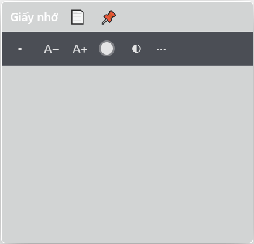

# 🪟 Sticky Glass

Tờ **giấy nhớ trong suốt** dán thẳng lên desktop, viết nhanh, đẹp và tối giản — dành cho Windows & macOS.

> Chữ luôn rõ 100%. Nền giấy có thể chỉnh từ **trong suốt → mờ → đậm** để nhìn xuyên qua ảnh nền desktop.



---

## ✨ Tính năng

| # | Tính năng |
|---|-----------|
| 1 | Soạn thảo rich-text: **màu chữ**, danh sách chấm đầu dòng |
| 2 | Nút **A+ / A−** tăng giảm cỡ chữ nhanh (10–40px) |
| 3 | **Font chữ tùy chỉnh**: tự cài `.ttf / .otf / .woff2` qua menu **⋯ → Cài font chữ**; chọn font ngay trong menu ⋯ |
| 4 | Giao diện kính mờ: khung trắng, chữ trắng, tối giản, hiện đại, ṕ blur nền |
| 5 | Hai chế độ: **📌 Ghim luôn ở trên** (Always on top) ↔ bình thường |
| 6 | Không chiếm taskbar — sống trong **khay hệ thống** (cạnh đồng hồ) |
| 7 | **Kéo kích thước** 8 hướng; chữ tự xuống dòng / dãn ra theo diện tích |
| 8 | Viết dài **tự mở rộng xuống dưới**, không thanh cuộn |
| 9 | **Tự khởi động cùng máy tính** (bật/tắt trong tùy chọn) |
| 10 | Gõ nhanh kiểu markdown: `# ` → H1, `### ` → H3, `[] ` → ô tích, `* ` → chấm đầu dòng, `1. ` → đánh số |
| 11 | Nhiều giấy nhớ cùng lúc, mỗi tờ nhớ vị trí, kích thước, kiểu chữ riêng |
| 12 | Đếm từ / ký tự |
| 13 | Menu chuột phải ngay trong giấy: cỡ chữ, danh sách, copy/paste |
| 14 | Xuất giấy nhớ ra file `.txt` |
| 15 | Phím tắt toàn cục **Ctrl+Shift+N**: hiện/ẩn tất cả giấy nhớ |

---

## 🚀 Cài đặt

### Windows
1. Tải bộ cài **`StickyGlass-Setup-1.0.0.exe`** từ thư mục `dist/` (hoặc từ [GitHub Actions](https://github.com/) artifacts).
2. Chạy file exe, cài đặt xong ứng dụng tự mở.
3. (Tùy chọn) Bật *"Tự khởi động cùng máy"* trong menu ⋯ của giấy nhớ.

### macOS
1. Bộ cài `.dmg` phải được build trên máy Mac — xem phần *"Build bộ cài"* bên dưới cho 2 cách (local / GitHub Actions).
2. Mở DMG, kéo **Sticky Glass** vào thư mục `Applications`.
3. Lần đầu mở: chuột phải → *Open* (hoặc vào *System Settings → Privacy & Security*) vì ứng dụng chưa ký số.
4. Nếu muốn ứng dụng nằm ở menu bar thay vì Dock: tắt *"Show in Dock"* trong tùy chọn Dock.

---

## 🛠 Build bộ cài

### Yêu cầu
- Node.js ≥ 20 (máy dev)
- Windows: build `.exe` (NSIS); macOS: build `.dmg`

```bash
npm install
npm run icons          # sinh icon (đã có sẵn trong build/)
npm run dist:win       # → dist/StickyGlass-Setup-1.0.0.exe
npm run dist:mac       # → dist/StickyGlass-1.0.0-x64.dmg / arm64.dmg (chỉ chạy được trên macOS)
```

> ⚠️ `electron-builder` chỉ tạo được `.dmg` khi chạy **trên macOS** (do Apple định dạng). Trên Windows chỉ build được `.exe`.

### Cách nhận cả `.exe` lẫn `.dmg` không cần máy Mac
1. Push repo lên GitHub.
2. Vào tab **Actions → Build installers → Run workflow** (hoặc push tag `v1.0.0`).
3. Pipeline tự build cả hai trên `windows-latest` và `macos-13`, tải về từ phần **Artifacts**.

---

## ⌨️ Phím tắt

| Phím | Tác dụng |
|------|----------|
| `Ctrl+B / I / U` | Đậm / nghiêng / gạch chân |
| `#␣` | Tiêu đề H1 |
| `##␣` / `###␣` | H2 / H3 |
| `*␣` | Danh sách chấm đầu dòng |
| `*␣` / `1.␣` | Danh sách chấm / đánh số |
| `Ctrl+Shift+N` | Hiện/ẩn tất cả giấy nhớ (toàn cục) |
| `Enter` | Trong ô tích: tạo ô tích mới |
| `Backspace` | Trong ô tích rỗng: xóa ô tích |

---

## ⚙️ Cấu trúc

```
sticky-note/
├─ src/
│  ├─ main/
│  │  ├─ main.js      # cửa sổ trong suốt, tray, auto-start, IPC
│  │  ├─ store.js     # lưu giấy nhớ (userData/notes.json)
│  │  └─ fonts.js     # cài font tùy chỉnh
│  ├─ preload.js      # cầu nối an toàn
│  └─ renderer/       # giao diện (HTML/CSS/JS thuần)
├─ scripts/make-icons.js  # sinh icon không cần công cụ ngoài
├─ build/             # icon.ico / icon.png
└─ .github/workflows/build.yml
```

**Dữ liệu nằm ở:**
- Windows: `%APPDATA%/Sticky Glass/notes.json` + `fonts/`
- macOS: `~/Library/Application Support/Sticky Glass/notes.json` + `fonts/`

---

## ❓ Câu hỏi thường gặp

**Làm sao để tự cài font?**
Vào menu **⋯ → Cài font chữ**, chọn file `.ttf/.otf`. Font xuất hiện trong ô chọn font (cũng nằm trong menu ⋯) của mọi giấy nhớ.

**Nền trong suốt quá, đọc không thấy chữ?**
Nút **◐** trên thanh công cụ: kéo slider hoặc bấm *Trong suốt / Mờ / Đậm*. Chữ luôn giữ độ đậm 100%.

**Muốn giấy cố định kích thước, không tự phồng?**
Menu **⋯ → bỏ tích "Tự mở rộng khi viết kín"** — khi đó kéo chỉnh kích thước thủ công hoàn toàn.

**Ứng dụng chạy ngầm ở đâu?**
Biểu tượng trắng nhỏ ở khay hệ thống (cạnh đồng hồ). Bấm đúp để hiện/ẩn tất cả giấy nhớ, chuột phải để quản lý.

---

## 🧪 Chạy bản phát triển

```bash
npm install
npm start
```

Thêm flag `--capture` để chụp ảnh màn hình demo vào `captures/demo.png`.
