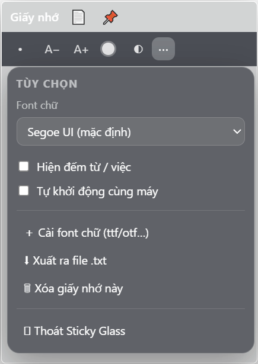
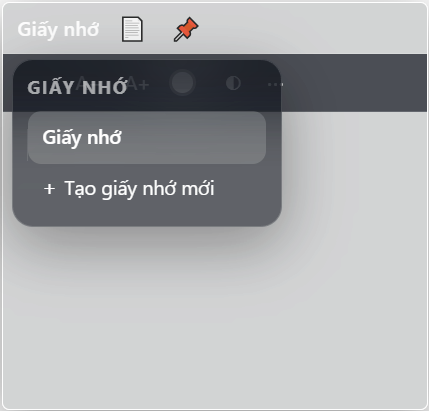

<p align="center">
  
</p>

<h1 align="center">🪟 Sticky Glass</h1>

<p align="center">
  <b>Tờ giấy nhớ trong suốt</b> dán thẳng lên desktop — viết nhanh, đẹp, tối giản.<br>
  Windows & macOS · chạy ngầm ở khay hệ thống · chữ luôn rõ 100%, nền chỉnh trong suốt–mờ–đậm
</p>

<p align="center">
  
  
  
</p>





---

## ✨ Tính năng

| # | Tính năng |
|---|-----------|
| 1 | Soạn thảo nhanh: danh sách chấm đầu dòng, màu chữ, cỡ chữ **A+ / A−** |
| 2 | **Nền kính mờ**: chỉnh độ trong suốt (đậm → mờ → trong suốt) bằng nút **◐** — chữ luôn đậm 100% |
| 3 | [Font chữ tùy chỉnh**: tự cài `.ttf / .otf / .woff2` qua menu **⋯ → Cài font chữ** |
| 4 | Giao diện **nền đen tối giản**, viền trắng nét, góc bo 5px, thanh công cụ **tự ẩn/hiện** khi soạn |
| 5 | **📌 Ghim luôn ở trên** (Always on top) ↔ bình thường |
| 6 | Không chiếm taskbar — sống trong **khay hệ thống** (cạnh đồng hồ) |
| 7 | Kéo kích thước 8 hướng; chữ tự xuống dòng theo bề rộng |
| 8 | Giấy **cố định kích thước**, không tự phình khi gõ; cuộn nhẹ khi chữ dài |
| 9 | **Tự khởi động cùng máy** (bật/tắt trong menu ⋯) |
| 10 | Gõ nhanh: `* ` + phím cách → danh sách chấm |
| 11 | Nhiều giấy nhớ cùng lúc, mỗi tờ nhớ vị trí/kích thước/kiểu riêng; nút **📄** xem & chuyển |
| 12 | Đếm từ / ký tự ở footer |
| 13 | Menu chuột phải ngay trong giấy: cỡ chữ, danh sách, copy/paste |
| 14 | Xuất giấy nhớ ra file `.txt` |
| 15 | Menu dropdown **tràn ra ngoài giấy**, tự lật lên khi thiếu chỗ, không bao giờ bị cắt |
| 16 | Phím tắt toàn cục **Ctrl+Shift+N**: hiện/ẩn tất cả giấy nhớ |

---

## 🚀 Cài đặt

### Windows
1. Tải **`StickyGlass-Setup-1.0.0.exe`** (bản build sẵn trong thư mục `dist/`, hoặc từ **Actions** trên GitHub).
2. Chạy file exe → ứng dụng tự mở.

### macOS
- Bộ cài `.dmg` cần build trên máy Mac (xem bên dưới).

---

## 🛠 Build bộ cài

| Nền tảng | Lệnh | Kết quả |
|---|---|---|
| Windows | `npm run dist:win` | `dist/StickyGlass-Setup-1.0.0.exe` |
| macOS | `npm run dist:mac` (chạy trên macOS) | `dist/StickyGlass-1.0.0-arm64.dmg` (và x64) |

### Cách lấy cả `.exe` lẫn `.dmg` không cần máy Mac
Repo này có sẵn **GitHub Actions** (`.github/workflows/build.yml`):
1. Vào tab **Actions → Build installers → Run workflow** (hoặc push tag `v1.0.0`).
2. Pipeline tự build cả hai trên `windows-latest` + `macos-13` → tải từ **Artifacts**.

---

## ⌨️ Phím tắt

| Phím | Tác dụng |
|------|----------|
| `*␣` | Danh sách chấm đầu dòng |
| `Ctrl+Shift+N` | Hiện/ẩn tất cả giấy nhớ (toàn cục) |
| A+ / A− | Tăng / giảm cỡ chữ |

---

## ⚙️ Cấu trúc

```
glass-sticky-note/
├─ src/
│  ├─ main/
│  │  ├─ main.js      # cửa sổ trong suốt, tray, auto-start, IPC, selftest
│  │  ├─ store.js     # lưu giấy nhớ (userData/notes.json)
│  │  └─ fonts.js     # cài font tùy chỉnh
│  ├─ preload.js      # cầu nối an toàn
│  └─ renderer/       # giao diện (HTML/CSS/JS thuần)
├─ scripts/make-icons.js  # sinh icon không cần công cụ ngoài
├─ build/             # icon.ico / icon.png
├─ captures/          # ảnh demo cho README
└─ .github/workflows/build.yml
```

**Dữ liệu nằm ở:**
- Windows: `%APPDATA%/Sticky Glass/notes.json` + `fonts/`
- macOS: `~/Library/Application Support/Sticky Glass/notes.json` + `fonts/`

---

## 🧪 Chạy bản phát triển

```bash
npm install
npm start          # chạy app
npm test           # chạy bộ tự kiểm tra (selftest) — mọi lỗi tự động báo
npm run icons      # tái tạo icon nếu cần
```

---

## ❓ Câu hỏi thường gặp

**Làm sao cài font tự chọn?**
Menu **⋯ → Cài font chữ**, chọn `.ttf/.otf`. Font xuất hiện trong ô chọn font (menu ⋯) của mọi giấy nhớ.

**Nền trong suốt quá?**
Nút **◐**: kéo slider hoặc bấm *Trong suốt / Mờ / Đậm* — chữ luôn rõ 100%.

**Muốn kéo giấy?**
Nắm **khoảng trống phía trên** (cạnh tiêu đề) để kéo di chuyển; bấm đúng chữ tiêu đề mới sửa title. Kéo mép/góc dưới để đổi kích thước.

**Tắt app?**
Chuột phải tray icon → **Thoát Sticky Glass**, hoặc **⋯ → Thoát**.

---

## 📄 Giấy phép
MIT
